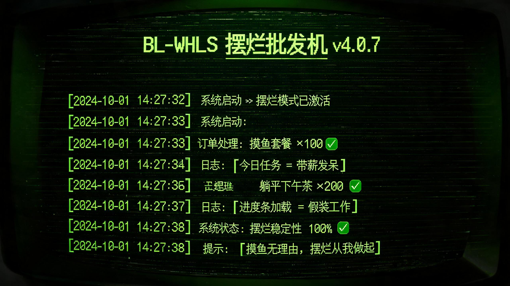

# BL-WHLS 摆烂批发机 v4.0.7

> 黑客终端风格的摆烂语录批发机 —— 开机即跑，持续批量生产摆烂弹药，看着它忙，或者输入命令自己下单批发都行。



## 这是什么

一台在黑客终端里高速运转的摆烂批发工厂。它开机即运行，屏幕上自动滚动系统日志、订单流水线、库存变动、警告消息——每一行都是冷面正经的工程腔，说的全是不正经的事。

**它解决的问题很具体**：让每一个想摆烂的人，都能摆得有理由、有章法、有尊严。

## 三个词的咬合

本项目诞生于 TRAE Friends 城市活动现场抽到的三张卡片：

| 主题词 | 角色 | 落地方式 |
|--------|------|----------|
| 摆烂 | 血肉 | 7 大品类 90+ 条语录，模块名全是摆烂味（BL-CORE / WHLS-ENGINE / ORDER-SYS） |
| 批发机 | 骨架 | 完整流水线：订单 → 生产 → 质检 → 打包 → 发货，每单 3-8 条起批 |
| 黑客终端风 | 皮囊 | 绿字黑底、CRT 扫描线、时间戳日志格式、永远闪烁的光标 |

三者不是并列叠加，是互相咬合：**在一个看起来正经硬核的黑客终端里，一台完整的批发机流水线在高速运转，而它批发出来的每一件商品，都是摆烂。**

## 运行

无需安装任何依赖，直接用浏览器打开 `index.html` 即可。

```
git clone https://github.com/sevenez/bailan-wholesale-machine.git
cd bailan-wholesale-machine
# 双击 index.html 或拖入浏览器
```

## 核心体验

- **自动运行**：6 种行类型（系统日志 / 语录批发 / 库存变动 / 警告异常 / 订单流水线 / 内部碎碎念）随机调度，节奏 40ms~1800ms 波动，偶尔触发一个完整订单链
- **实时状态**：摆烂指数、今日已批发总量、运行时长持续跳动
- **不强制交互**：底部输入框随时等你，但输不输都不影响它自己跑

## 可选命令

| 命令 | 作用 |
|------|------|
| `help` | 显示命令清单 |
| `list` | 查看可批发的摆烂品类 |
| `inventory` | 查看各品类库存 |
| `order <品类> <数量>` | 下单批发，如 `order 摸鱼理由 5` |
| `status` | 查看运行状态与今日批发量 |
| `stop` / `start` | 暂停 / 恢复自动输出 |
| `clear` | 清屏 |
| 随便乱输 | `command not found` + 一句摆烂味吐槽 |

## 品类一览

摸鱼理由 / 躺平宣言 / 下班借口 / 请假理由 / 拖延语录 / 摸鱼技巧 / 人生感悟

## License

MIT
